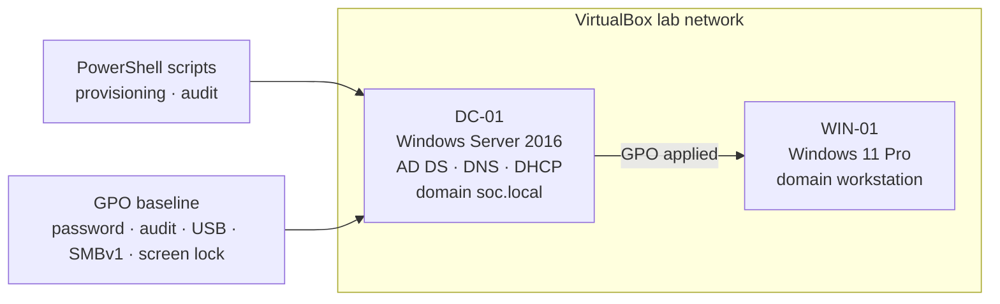

# Windows and Active Directory Home Lab

[](https://github.com/Yassine-ElJide/homelab-windows-ad/actions/workflows/lint.yml)
[](LICENSE)

A virtualized Active Directory domain to practice administration, Group Policy
hardening and PowerShell automation. It is the target domain reused in my
[SOC Home Lab](https://github.com/Yassine-ElJide/soc-home-lab).

## Context and objective

Active Directory is still the identity backbone of most companies, and the
first thing an attacker goes after once inside: weak password policies, stale
accounts, unmonitored privileged groups and legacy protocols are among the
most common findings in AD security assessments.

The objective of this lab is to build a domain the way it should be run day to
day: a deliberate OU structure, a documented GPO security baseline, and
repeatable PowerShell scripts for provisioning and account hygiene instead of
manual clicks in the console.

## Architecture



| Host | Role | OS |
| --- | --- | --- |
| DC-01 | AD DS, DNS, DHCP for domain `soc.local` | Windows Server 2016 |
| WIN-01 | Domain workstation | Windows 11 Pro |

OU structure created by [`scripts/New-LabOU.ps1`](scripts/New-LabOU.ps1):

```text
soc.local
└── OU=SOC
    ├── OU=Users
    │   ├── OU=IT
    │   ├── OU=Finance
    │   └── OU=HR
    ├── OU=Groups
    ├── OU=Workstations
    └── OU=Servers
```

## Technologies

- **Windows Server 2016**: AD DS, DNS, DHCP
- **Group Policy (GPMC)**: security and configuration baseline
- **PowerShell** with the `ActiveDirectory` module: provisioning and reporting
- **Oracle VirtualBox**: virtualization
- **PSScriptAnalyzer** and **markdownlint** in GitHub Actions

## What this project demonstrates

- Designing an OU tree so that GPO links and delegation follow the
  organisation, not individual objects.
- Writing PowerShell that is safe to run on a domain controller: idempotent,
  `-WhatIf` support on every state change, no secrets in files.
- Translating security guidance (CIS, ANSSI, NIST) into concrete GPO settings,
  with the reasoning for each value.
- Account hygiene: finding stale accounts and auditing privileged group
  membership on a schedule.
- Knowing which audit subcategories feed detection, since this domain is the
  log source of the SOC lab.

## Technical choices and trade-offs

| Choice | Why | Trade-off |
| --- | --- | --- |
| OUs split by object type (Users, Groups, Workstations, Servers) with departments under Users | Computer GPOs (USB, screen lock) and user GPOs can be linked to the right scope without filtering | A deeper tree to maintain |
| Scripts are idempotent and support `-WhatIf` | They can be re-run safely and previewed on a domain controller | More code than a one-shot script |
| Initial password read with `Read-Host -AsSecureString`, users must change it at first logon | No password in the CSV or in the repository | Bulk creation is interactive |
| OUs created with `ProtectedFromAccidentalDeletion` | A misclick cannot delete a branch of the directory | Deleting an OU on purpose needs an extra step |
| No forced password expiry, 14-character minimum | Current NIST and ANSSI guidance favours length over periodic rotation | Relies on detecting compromise to trigger a reset |
| Lockout after 5 failures for 15 minutes | Slows down online guessing | An attacker can deliberately lock accounts; detection of spraying (SOC lab) is the complement |
| `Write-Host` allowed in provisioning scripts | They run interactively; reports are returned as objects | Excluded from PSScriptAnalyzer, with the reason in [`PSScriptAnalyzerSettings.psd1`](PSScriptAnalyzerSettings.psd1) |

## Security

The full baseline with GPMC paths is in [`gpo/baseline.md`](gpo/baseline.md).

| Control | Scope | Threat mitigated | MITRE ATT&CK |
| --- | --- | --- | --- |
| Password and lockout policy | Domain | Password guessing and spraying | T1110 Brute Force |
| Advanced audit policy | Domain Controllers | Blind spots for detection (feeds the SOC lab rules) | Detection for T1558.003, T1098.007, T1110.003 |
| Deny write to removable disks | Workstations OU | Data exfiltration to USB storage | T1052.001 Exfiltration over USB |
| Disable SMBv1 (server and client) | All computers | Exploitation of a legacy protocol | T1210 Exploitation of Remote Services |
| 10-minute machine inactivity lock | Workstations OU | Use of an unattended, unlocked session | - |
| Stale account report | Domain | Dormant accounts reused by an attacker | T1078.002 Valid Accounts: Domain Accounts |
| Privileged group audit | Domain | Unauthorised additions to Tier 0 groups | T1098.007 Additional Local or Domain Groups |

Risks taken into account in the lab: the domain is isolated, uses only
fictitious users ([`scripts/users.csv`](scripts/users.csv)), and no password
is stored anywhere in the repository.

## Installation and reproduction

1. Create two VMs on a VirtualBox internal network: DC-01 (Windows Server
   2016) and WIN-01 (Windows 11 Pro).
2. Promote DC-01 as the first domain controller of `soc.local` with DNS, add
   the DHCP role, and join WIN-01 to the domain (commands in the
   [SOC lab setup guide](https://github.com/Yassine-ElJide/soc-home-lab/blob/main/docs/setup.md)).
3. On DC-01, as a Domain Admin, preview then run the provisioning scripts:

   ```powershell
   .\scripts\New-LabOU.ps1 -WhatIf
   .\scripts\New-LabOU.ps1
   .\scripts\New-LabUsers.ps1 -CsvPath .\scripts\users.csv -WhatIf
   .\scripts\New-LabUsers.ps1 -CsvPath .\scripts\users.csv
   ```

4. Create and link the GPOs described in [`gpo/baseline.md`](gpo/baseline.md),
   then check the effective policy on WIN-01 with `gpresult /h gpreport.html`
   and `auditpol /get /category:*`.
5. Run the read-only audit scripts:

   ```powershell
   .\scripts\Get-StaleAccounts.ps1 -Days 90 | Export-Csv stale.csv -NoTypeInformation
   .\scripts\Get-PrivilegedGroupMembers.ps1 | Export-Csv priv-members.csv -NoTypeInformation
   ```

| Script | Purpose | Changes state |
| --- | --- | --- |
| [`New-LabOU.ps1`](scripts/New-LabOU.ps1) | Create the OU structure | Yes (`-WhatIf` supported) |
| [`New-LabUsers.ps1`](scripts/New-LabUsers.ps1) | Bulk-create users from CSV, place them in their OU and group | Yes (`-WhatIf` supported) |
| [`Get-StaleAccounts.ps1`](scripts/Get-StaleAccounts.ps1) | Report enabled accounts inactive for N days, or never used | No |
| [`Get-PrivilegedGroupMembers.ps1`](scripts/Get-PrivilegedGroupMembers.ps1) | List effective members of privileged groups | No |

## Results

- The domain `soc.local` and its controller are in use as the target of the
  [SOC Home Lab](https://github.com/Yassine-ElJide/soc-home-lab#results),
  where screenshots of DC-01 are published.
- Every push runs PSScriptAnalyzer on the scripts and markdownlint on the
  documentation ([lint workflow](.github/workflows/lint.yml)).

## Limits and what I would do in production

- **One domain controller.** No redundancy for authentication or DNS. In
  production there would be at least two DCs per site, with monitored
  replication and tested system-state backups.
- **Windows Server 2016.** Its extended support ends in January 2027. A new
  deployment would use a current Windows Server release and a recent domain
  functional level.
- **No admin tiering.** The same Domain Admin account is used for everything.
  Production would separate Tier 0, 1 and 2 accounts, use privileged access
  workstations, and add Tier 0 accounts to the Protected Users group.
- **No LAPS.** Local administrator passwords are not managed. Windows LAPS
  would rotate them and store them in AD.
- **GPOs built by hand.** The baseline is documented but not exported.
  Production GPOs would be backed up, versioned and compared against the
  Microsoft Security Compliance Toolkit baselines.
- **Partial hardening.** SMB and LDAP signing, LDAP channel binding, NTLM
  restrictions and fine-grained password policies for admin and service
  accounts are not configured yet.
- **Audit scripts run manually.** In production they would run on a schedule
  and their output would be diffed and alerted on.

## Next steps

- Add a tiered admin model and Windows LAPS
- Export the GPOs as backups so the baseline can be rebuilt in one command
- Add screenshots of the OU tree, GPO links and `gpresult` output
- Schedule the audit scripts and forward their results to the SOC lab

## License

[MIT](LICENSE)
